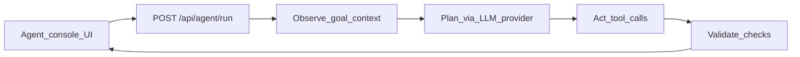

# Scout Loop (agentic demo)

End-to-end UI + tool-using agent loop for portfolio evidence on Frontend + Agentic roles.

## Loop



Phases returned to the UI:

1. **Observe** — capture goal / company / role
2. **Plan** — LLM (mock by default) selects tools as JSON
3. **Act** — execute `search_knowledge`, `fetch_company_profile`, `score_fit`
4. **Validate** — threshold checks before composing the briefing

## Stack

- Next.js App Router + TypeScript + Tailwind
- Route handler agent runtime (`src/lib/agent/*`)
- Vitest coverage for the loop

## LLM / tool swap point

`src/lib/agent/llm.ts` → `getLlmProvider()`

| Mode | Env | Behavior |
| --- | --- | --- |
| Mock (default) | unset | Deterministic planner, no network |
| OpenAI | `LLM_PROVIDER=openai` + `OPENAI_API_KEY` | Chat completions JSON plan |

Tools live in `src/lib/agent/tools.ts` — replace handlers with real search/CRM connectors without changing the UI.

## Run locally

```bash
npm install
npm run dev
```

Open [http://127.0.0.1:43122](http://127.0.0.1:43122).

```bash
npm test
npm run build
```

Optional real provider:

```bash
LLM_PROVIDER=openai OPENAI_API_KEY=sk-... npm run dev
```
