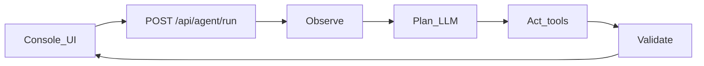

# Scout Loop — agentic demo

**Repo path:** `apps/agentic-demo`  

**Stack:** Next.js App Router · TypeScript · Tailwind · Vitest · mock LLM (OpenAI swap)  
**Local:** `cd apps/agentic-demo && npm run dev` → http://127.0.0.1:43122

## Problem

Variant B (Frontend + Agentic) applications need a credible, end-to-end demo: not a chat wrapper, but a product surface that runs a tool-using agent loop with plan traces, validation, and a clear path to real APIs. This supports interview storytelling for agent UX and AI-product FE roles.

## Architecture

- **Observe** — capture goal, company, role.
- **Plan** — `getLlmProvider()` returns mock or OpenAI JSON tool plan (`src/lib/agent/llm.ts`).
- **Act** — tools: `search_knowledge`, `fetch_company_profile`, `score_fit` (`src/lib/agent/tools.ts`).
- **Validate** — threshold checks before composing the briefing; UI shows phase trace + results.

## What senior ownership looks like

- Product FE for agents: streaming-style phase UI, failure states, human-readable validation.
- Swappable LLM/tools without rewriting the console.
- Loop covered by tests so demos stay honest under change.
- README architecture diagram for screens and Variant B talking points.

## Resume blurb

Shipped an end-to-end agentic demo (Next.js) with observe→plan→act→validate, mock tools, and an OpenAI swap point—showing FE ownership of agent product surfaces and tool-loop UX.
